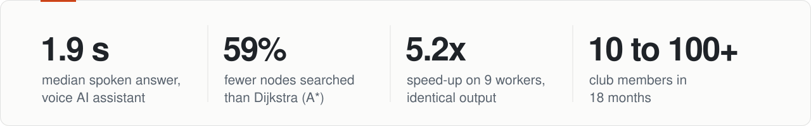

<picture>
  <source media="(prefers-color-scheme: dark)" srcset="./banner-dark.svg">
  
</picture>

  <a href="https://agrimsharma.com/resume.pdf"><b>Résumé</b></a>&nbsp;&nbsp;·&nbsp;&nbsp;<a href="https://agrimsharma.com">Portfolio</a>&nbsp;&nbsp;·&nbsp;&nbsp;<a href="https://linkedin.com/in/agrim-sharma-821788302">LinkedIn</a>&nbsp;&nbsp;·&nbsp;&nbsp;<a href="mailto:agrimsh22@gmail.com">agrimsh22@gmail.com</a>

I build real-time AI and concurrent systems in TypeScript, Python and Java. Most recently I worked on a voice AI meeting assistant at Viemo Capital. I'm finishing Computer Science (AI) at Adelaide University and looking for graduate software engineering roles from January 2027.

<picture>
  <source media="(prefers-color-scheme: dark)" srcset="./impact-dark.svg">
  
</picture>

## Where to look

**[Pathfinder](https://github.com/Agrim1305/Pathfinder)**: BFS, Dijkstra and A\* written from scratch, on elevation grids and a real Adelaide CBD map. Worth reading: the search core, its 13 unit tests, and the CI check that keeps the browser demo in step with the Python results.

**[MetaPlay](https://github.com/Agrim1305/Metaplay)**: the Node.js back end I built for a five-person team. 15+ REST endpoints, Google OAuth 2.0 with roles, and the MySQL to PostgreSQL migration I did alone to bring it back after an outage.

**[agrimsharma.com](https://github.com/Agrim1305/portfolio)**: Next.js site with a Claude assistant that can call tools. Inputs are schema-checked, actions are limited to an allowlist, and 350+ end-to-end tests cover it.

**[Pacific Village Explorer](https://github.com/reeyansh404/Pacific-Village-Explorer)**: hackathon finalist, top 12 of 110 teams. I led the AI recommendation engine, built in 44 hours.

My internship code is private, and so is my university coursework (a concurrent video player in Java and a compiler in C++). Happy to walk through either.

## How I work

- **Measure first.** Benchmarks, evaluation harnesses and tests in CI before I claim something is faster or fixed.
- **Small, reviewable changes.** 31 merged pull requests into a 22,000-line codebase during my internship.
- **Safe defaults for AI.** Fail-closed checks, no unsupervised actions, and API keys kept on the server.

Python · TypeScript · Java · C++ · SQL · React · Next.js · Node.js · Spring Boot · PostgreSQL · Docker · Azure · GitHub Actions
