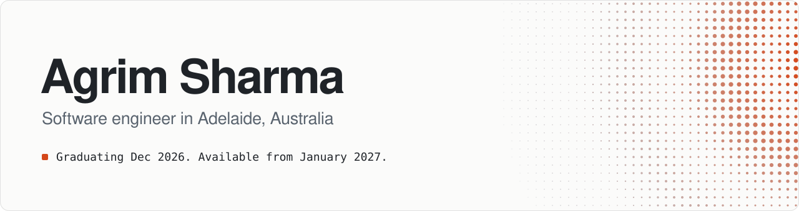
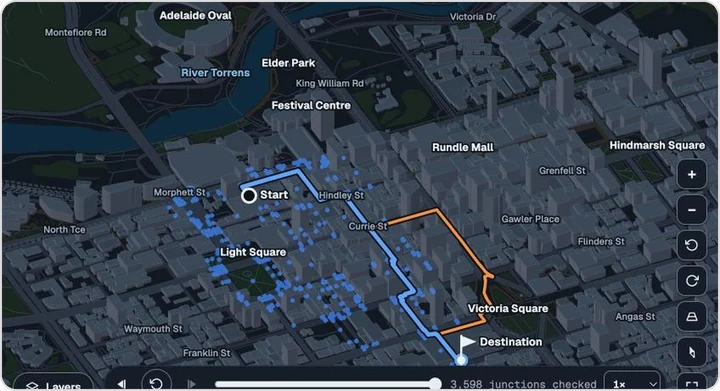
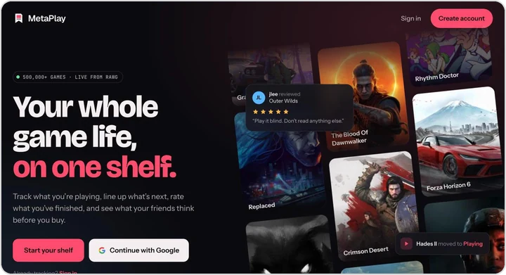
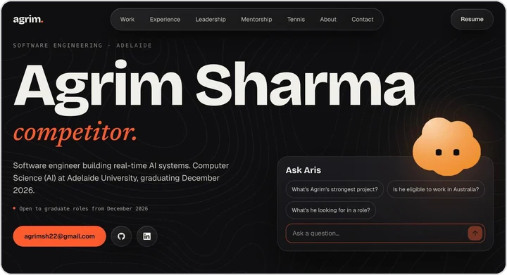
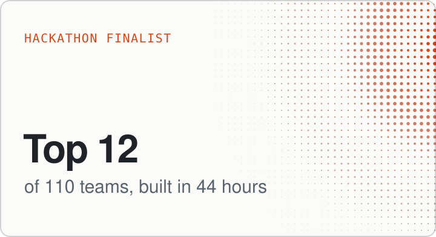
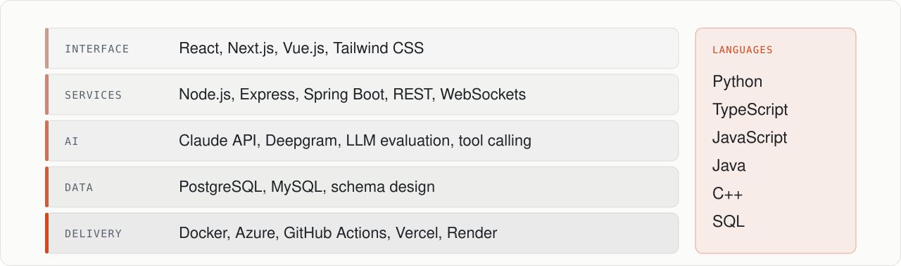

<picture>
  <source media="(prefers-color-scheme: dark)" srcset="./banner-dark.svg">
  
</picture>

  <a href="https://agrimsharma.com/resume.pdf"><b>Résumé</b></a>&nbsp;&nbsp;·&nbsp;&nbsp;<a href="https://agrimsharma.com">Portfolio</a>&nbsp;&nbsp;·&nbsp;&nbsp;<a href="https://linkedin.com/in/agrim-sharma-821788302">LinkedIn</a>&nbsp;&nbsp;·&nbsp;&nbsp;<a href="mailto:agrimsh22@gmail.com">agrimsh22@gmail.com</a>

I build real-time AI and concurrent systems in TypeScript, Python and Java. Most recently I worked on a voice AI meeting assistant at Viemo Capital. I'm finishing Computer Science (AI) at Adelaide University and looking for graduate software engineering roles from January 2027.

<picture>
  <source media="(prefers-color-scheme: dark)" srcset="./impact-dark.svg">
  
</picture>

## Where to look

<table>
<tr>
<td width="340" valign="middle"><a href="https://agrim1305.github.io/Pathfinder/"><picture><source media="(prefers-color-scheme: dark)" srcset="./shot-pathfinder-dark.webp"></picture></a></td>
<td valign="top">
<b><a href="https://github.com/Agrim1305/Pathfinder">Pathfinder</a></b> 
Python · JavaScript · GitHub Actions

BFS, Dijkstra and A* built from scratch, running on a real Adelaide CBD street map. A* finds the same route as Dijkstra while searching up to 59% fewer nodes, checked by 13 unit tests and a CI step that keeps the demo in step with the Python.

<a href="https://agrim1305.github.io/Pathfinder/">Live demo ↗</a>&nbsp;&nbsp;·&nbsp;&nbsp;<a href="https://github.com/Agrim1305/Pathfinder">Code</a>
</td>
</tr>
</table>

<table>
<tr>
<td width="340" valign="middle"><a href="https://metaplay-g2q7.onrender.com"><picture><source media="(prefers-color-scheme: dark)" srcset="./shot-metaplay-dark.webp"></picture></a></td>
<td valign="top">
<b><a href="https://github.com/Agrim1305/Metaplay">MetaPlay</a></b> 
Node.js · Express · Vue.js · PostgreSQL

Game tracking platform. I built the back end for a five-person team: 15+ REST endpoints and Google OAuth 2.0 with roles. A year later I brought it back alone after an outage, migrating MySQL to PostgreSQL.

<a href="https://metaplay-g2q7.onrender.com">Live site ↗</a> (first load can take 30 s)&nbsp;&nbsp;·&nbsp;&nbsp;<a href="https://github.com/Agrim1305/Metaplay">Code</a>
</td>
</tr>
</table>

<table>
<tr>
<td width="340" valign="middle"><a href="https://agrimsharma.com"><picture><source media="(prefers-color-scheme: dark)" srcset="./shot-portfolio-dark.webp"></picture></a></td>
<td valign="top">
<b><a href="https://github.com/Agrim1305/portfolio">agrimsharma.com</a></b> 
TypeScript · Next.js · Tailwind CSS · Claude API

Portfolio with a Claude assistant that can call tools. Inputs are schema-checked, actions come from an allowlist, and the API key stays on the server. Covered by 350+ end-to-end tests.

<a href="https://agrimsharma.com">Live site ↗</a>&nbsp;&nbsp;·&nbsp;&nbsp;<a href="https://github.com/Agrim1305/portfolio">Code</a>
</td>
</tr>
</table>

<table>
<tr>
<td width="340" valign="middle"><a href="https://github.com/reeyansh404/Pacific-Village-Explorer"><picture><source media="(prefers-color-scheme: dark)" srcset="./tile-pacific-dark.svg"></picture></a></td>
<td valign="top">
<b><a href="https://github.com/reeyansh404/Pacific-Village-Explorer">Pacific Village Explorer</a></b> 
React · Vite · Claude API

Climate adaptation planner for Pacific village councils. I led the AI recommendation engine, grounding each suggestion in IPCC climate data and each village’s population and budget.

<a href="https://github.com/reeyansh404/Pacific-Village-Explorer">Code</a>
</td>
</tr>
</table>

My internship code is private, and so is my university coursework (a concurrent video player in Java and a compiler in C++). Happy to walk through either.

## How I work

- **Measure first.** Benchmarks, evaluation harnesses and tests in CI before I claim something is faster or fixed.
- **Small, reviewable changes.** 31 merged pull requests into a 22,000-line codebase during my internship.
- **Safe defaults for AI.** Fail-closed checks, no unsupervised actions, and API keys kept on the server.

## Toolkit

<picture>
  <source media="(prefers-color-scheme: dark)" srcset="./toolkit-dark.svg">
  
</picture>
